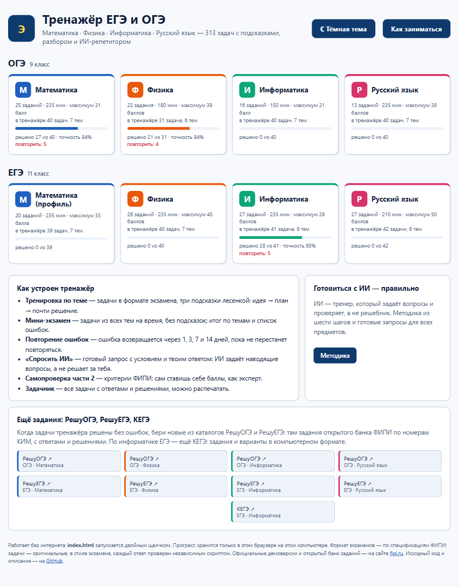
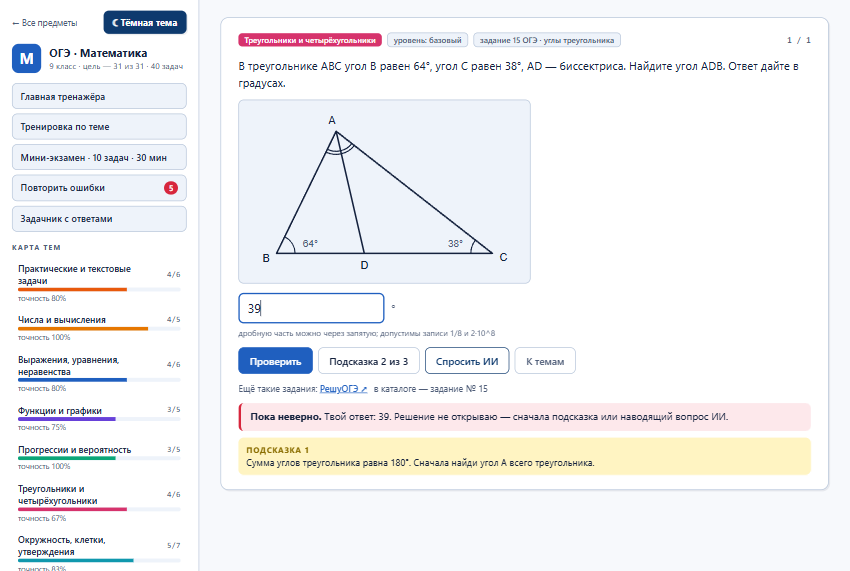
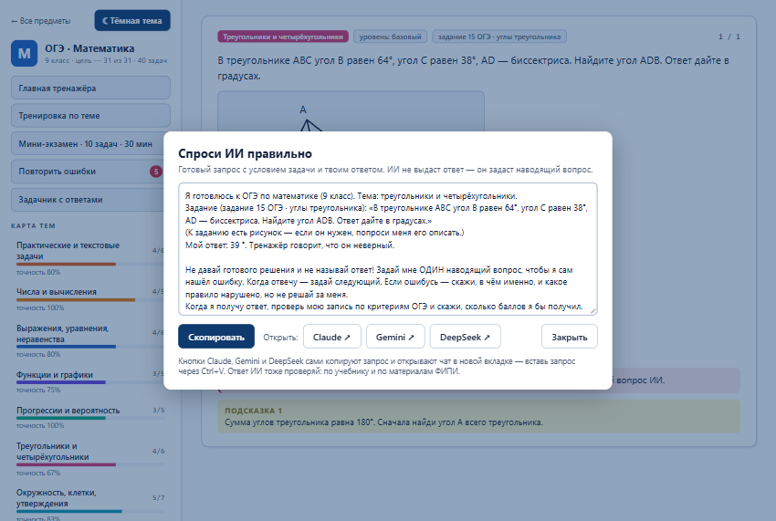
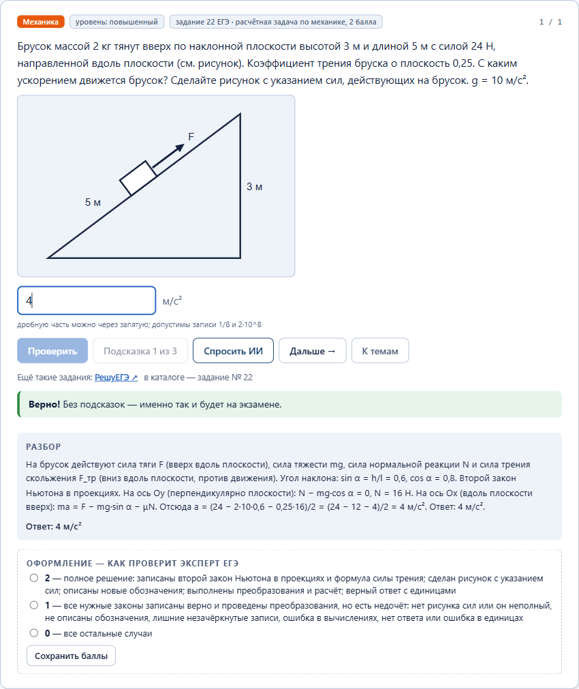
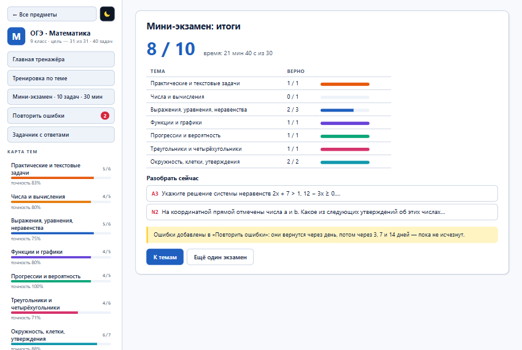
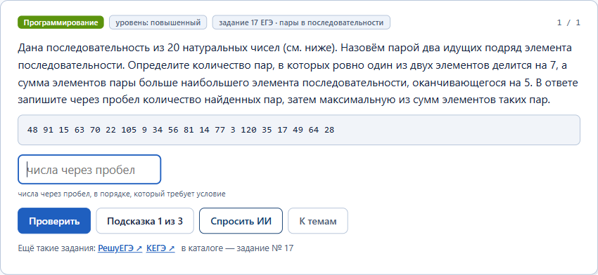
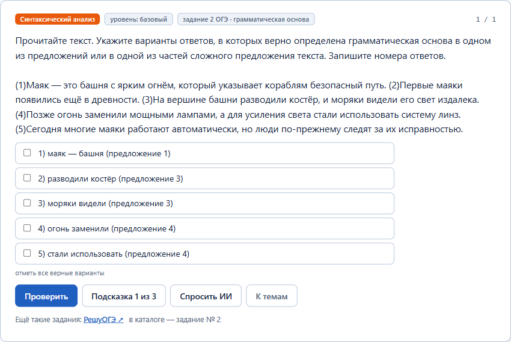
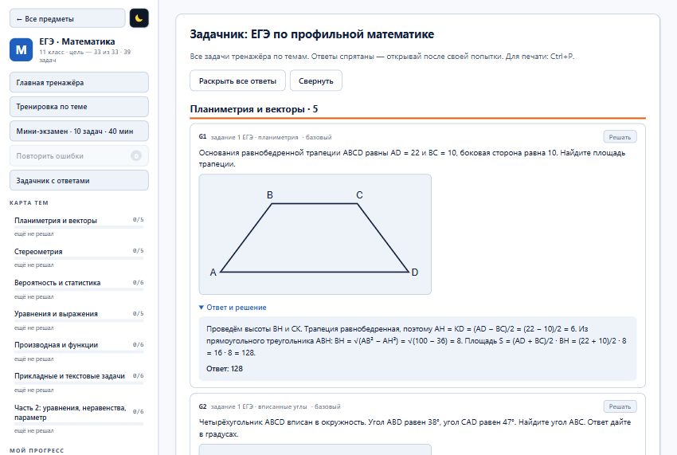
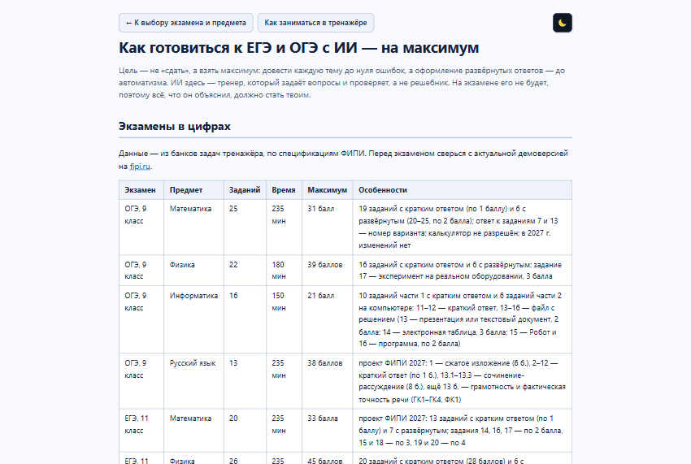
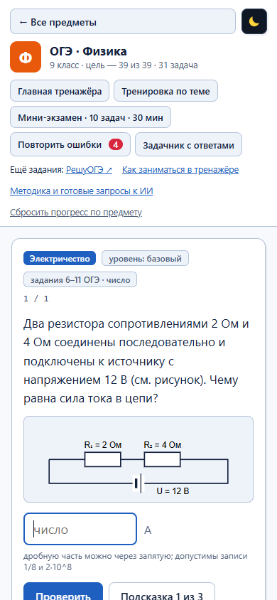

# Тренажёр ЕГЭ и ОГЭ

Тренажёр для подготовки к ОГЭ (9 класс) и ЕГЭ (11 класс) по четырём предметам: **математика, физика, информатика, русский язык**.
313 задач в формате экзаменов, подсказки, разборы, мини-экзамены, повторение ошибок и ИИ-репетитор, который задаёт наводящие вопросы, а не решает за ученика.

### ▶ [Тренажёр](https://alex-invntr.github.io/EGE_OGE_Test_Trainer/) · [Как заниматься](https://alex-invntr.github.io/EGE_OGE_Test_Trainer/howto.html) · [Методика подготовки с ИИ](https://alex-invntr.github.io/EGE_OGE_Test_Trainer/guide.html) · [Скачать ZIP](https://github.com/alex-invntr/EGE_OGE_Test_Trainer/archive/refs/heads/master.zip)

Без установки и регистрации: обычные HTML-страницы, работают в браузере на компьютере и на телефоне, в том числе без интернета. Прогресс хранится в браузере ученика.

<picture>
  <source media="(prefers-color-scheme: dark)" srcset="screenshots/dark/01_home.png">
  <source media="(prefers-color-scheme: light)" srcset="screenshots/light/01_home.png">
  
</picture>

## Предметы

| | ОГЭ, 9 класс | ЕГЭ, 11 класс |
|---|---|---|
| **Математика** | [40 задач, 7 тем](https://alex-invntr.github.io/EGE_OGE_Test_Trainer/trainer.html?b=oge_math) | [39 задач, 7 тем, профиль](https://alex-invntr.github.io/EGE_OGE_Test_Trainer/trainer.html?b=ege_math) |
| **Физика** | [31 задача, 6 тем](https://alex-invntr.github.io/EGE_OGE_Test_Trainer/trainer.html?b=oge_physics) | [40 задач, 7 тем](https://alex-invntr.github.io/EGE_OGE_Test_Trainer/trainer.html?b=ege_physics) |
| **Информатика** | [40 задач, 7 тем](https://alex-invntr.github.io/EGE_OGE_Test_Trainer/trainer.html?b=oge_informatics) | [41 задача, 8 тем](https://alex-invntr.github.io/EGE_OGE_Test_Trainer/trainer.html?b=ege_informatics) |
| **Русский язык** | [40 задач, 7 тем](https://alex-invntr.github.io/EGE_OGE_Test_Trainer/trainer.html?b=oge_russian) | [42 задачи, 8 тем](https://alex-invntr.github.io/EGE_OGE_Test_Trainer/trainer.html?b=ege_russian) |

Формат экзаменов — по спецификациям ФИПИ на 2027 год:

| Экзамен | Предмет | Заданий | Время | Максимум баллов |
|---|---|---|---|---|
| ОГЭ | Математика | 25 | 235 мин | 31 |
| ОГЭ | Физика | 22 | 180 мин | 39 |
| ОГЭ | Информатика | 16 | 150 мин | 21 |
| ОГЭ | Русский язык | 13 | 235 мин | 38 |
| ЕГЭ | Математика, профиль | 20 | 235 мин | 33 |
| ЕГЭ | Физика | 26 | 235 мин | 45 |
| ЕГЭ | Информатика | 27 | 235 мин | 29 |
| ЕГЭ | Русский язык | 27 | 210 мин | 50 |

Документы ФИПИ на 2027 год пока опубликованы как проекты. Перед экзаменом сверьтесь с актуальной демоверсией на [fipi.ru](https://fipi.ru).

## Как заниматься

### Тренировка по теме: сначала сам, потом подсказка, потом ИИ

Решение открывается только после попытки. После ошибки появляется первая подсказка, всего их три: идея, план, почти решение.

<picture>
  <source media="(prefers-color-scheme: dark)" srcset="screenshots/dark/02_task_hint.png">
  <source media="(prefers-color-scheme: light)" srcset="screenshots/light/02_task_hint.png">
  
</picture>

### «Спросить ИИ»: наводящие вопросы вместо готового ответа

Кнопка собирает готовый запрос с условием задачи и ответом ученика. Кнопки в окне сами копируют его и открывают [Claude](https://claude.ai), [Gemini](https://gemini.google.com) или [DeepSeek](https://chat.deepseek.com) — остаётся вставить запрос. В запросе прямо сказано: не называть ответ, задать один наводящий вопрос и проверить запись по критериям экзамена.

<picture>
  <source media="(prefers-color-scheme: dark)" srcset="screenshots/dark/03_ask_ai.png">
  <source media="(prefers-color-scheme: light)" srcset="screenshots/light/03_ask_ai.png">
  
</picture>

### Вторая часть: разбор и самопроверка по критериям ФИПИ

После верного ответа на задачу с развёрнутым решением ученик видит полный разбор и ставит себе баллы по критериям эксперта.

<picture>
  <source media="(prefers-color-scheme: dark)" srcset="screenshots/dark/04_solution_criteria.png">
  <source media="(prefers-color-scheme: light)" srcset="screenshots/light/04_solution_criteria.png">
  
</picture>

### Мини-экзамен и повторение ошибок

Мини-экзамен идёт на время и без подсказок, в нём по задаче из каждой темы. Итог показан по темам. Каждая ошибка попадает в «Повторить ошибки» и возвращается через 1, 3, 7 и 14 дней, пока не перестанет повторяться.

<picture>
  <source media="(prefers-color-scheme: dark)" srcset="screenshots/dark/05_exam_result.png">
  <source media="(prefers-color-scheme: light)" srcset="screenshots/light/05_exam_result.png">
  
</picture>

### Информатика и русский язык

В задачах по информатике программы и данные показаны с отступами. Ответ может состоять из нескольких чисел. В русском языке есть тексты с пронумерованными предложениями и позициями знаков, изложение и сочинение с образцом и критериями.

<picture>
  <source media="(prefers-color-scheme: dark)" srcset="screenshots/dark/06_informatics.png">
  <source media="(prefers-color-scheme: light)" srcset="screenshots/light/06_informatics.png">
  
</picture>

<picture>
  <source media="(prefers-color-scheme: dark)" srcset="screenshots/dark/07_russian.png">
  <source media="(prefers-color-scheme: light)" srcset="screenshots/light/07_russian.png">
  
</picture>

### Задачник для учителя

Все задачи предмета на одной странице, ответы и решения спрятаны под спойлером. Страницу можно распечатать.

<picture>
  <source media="(prefers-color-scheme: dark)" srcset="screenshots/dark/08_book.png">
  <source media="(prefers-color-scheme: light)" srcset="screenshots/light/08_book.png">
  
</picture>

### Ещё задания: РешуОГЭ, РешуЕГЭ, КЕГЭ

Когда задачи тренажёра решены без ошибок, новые задания берутся из каталогов РешуОГЭ и РешуЕГЭ: там задания открытого банка ФИПИ по номерам КИМ, с ответами и решениями. По информатике ЕГЭ — ещё КЕГЭ. Под каждой задачей тренажёра есть ссылка на нужный каталог и номер задания.

| | ОГЭ, 9 класс | ЕГЭ, 11 класс |
|---|---|---|
| **Математика** | [РешуОГЭ](https://math-oge.sdamgia.ru/prob_catalog) | [РешуЕГЭ](https://math-ege.sdamgia.ru/prob_catalog) |
| **Физика** | [РешуОГЭ](https://phys-oge.sdamgia.ru/prob_catalog) | [РешуЕГЭ](https://phys-ege.sdamgia.ru/prob_catalog) |
| **Информатика** | [РешуОГЭ](https://inf-oge.sdamgia.ru/prob_catalog) | [РешуЕГЭ](https://inf-ege.sdamgia.ru/prob_catalog) · [КЕГЭ](https://kompege.ru/) |
| **Русский язык** | [РешуОГЭ](https://rus-oge.sdamgia.ru/prob_catalog) | [РешуЕГЭ](https://rus-ege.sdamgia.ru/prob_catalog) |

Задания с этих сайтов в репозиторий не копируются: тренажёр ссылается на их каталоги.

### Тёмная и светлая тема

По умолчанию тренажёр тёмный. Квадратная кнопка с солнцем или луной в шапке главной, в меню тренажёра и вверху страниц переключает оформление, выбор запоминается в браузере. Картинки в этом README показываются в теме GitHub, а здесь — другая тема:

<picture>
  <source media="(prefers-color-scheme: dark)" srcset="screenshots/light/02_task_hint.png">
  <source media="(prefers-color-scheme: light)" srcset="screenshots/dark/02_task_hint.png">
  
</picture>

### Методика «6 шагов» и готовые запросы к ИИ

[Методика](https://alex-invntr.github.io/EGE_OGE_Test_Trainer/guide.html) объясняет, как готовиться с ИИ на максимум баллов. Там же готовые запросы для каждого шага и советы по каждому предмету.

<picture>
  <source media="(prefers-color-scheme: dark)" srcset="screenshots/dark/09_guide.png">
  <source media="(prefers-color-scheme: light)" srcset="screenshots/light/09_guide.png">
  
</picture>

### На телефоне

<picture>
  <source media="(prefers-color-scheme: dark)" srcset="screenshots/dark/10_phone.png">
  <source media="(prefers-color-scheme: light)" srcset="screenshots/light/10_phone.png">
  
</picture>

## Как запустить

- **Онлайн:** [alex-invntr.github.io/EGE_OGE_Test_Trainer](https://alex-invntr.github.io/EGE_OGE_Test_Trainer/).
- **С диска, без интернета:** [скачайте ZIP](https://github.com/alex-invntr/EGE_OGE_Test_Trainer/archive/refs/heads/master.zip), распакуйте и запустите `index.html` двойным щелчком. Или склонируйте репозиторий:

```bash
git clone https://github.com/alex-invntr/EGE_OGE_Test_Trainer.git
```

Работает в Chrome, Edge, Firefox и Яндекс Браузере. Все пути относительные, поэтому одна и та же папка работает и с диска, и на GitHub Pages.

## Как проверены задачи

Задачи оригинальные, в стиле экзаменов. Ни один ответ не взят «на веру».

- **Пересчёт ответов.** Для каждого банка есть скрипт `tools/check_<экзамен>_<предмет>.py`. Он заново вычисляет ответы по данным условия: формулы физики, правила буравчика и левой руки через векторное произведение, уравнения и производные через sympy, программы по информатике — выполнением кода и перебором. Для русского языка скрипт сверяет ответы с полными верными написаниями слов и расставленными знаками препинания.
- **Слепое решение.** В русском языке норму не пересчитать кодом. Поэтому отдельный ИИ-агент получил задания без ответов, решил их сам, и его ответы сравнили с банком.
- **Прогон в браузере.** Скрипт `tools/trainer_check.js` открывает страницы с диска в Chrome или Edge в фоне. Для каждой задачи он вводит неверный ответ и проверяет, что тот отклонён, затем вводит верный и проверяет, что тот принят. Ещё он прогоняет мини-экзамен, подсказки, повторение ошибок, задачник и запросы к ИИ.
- **Рисунки.** Чертежи и графики сверены с ответами по клеткам и размерам. Для графиков функций скрипт проверки читает точки прямо из рисунка.

| Банк | Задач | Ответ пересчитан кодом | Слепое решение совпало | Свободный ответ: образец и критерии |
|---|---|---|---|---|
| ОГЭ · математика | 40 | 39 | — | 1 |
| ОГЭ · физика | 31 | 30 | — | 1 |
| ОГЭ · информатика | 40 | 40 | — | 0 |
| ОГЭ · русский язык | 40 | 17 | 37 из 37 | 3 |
| ЕГЭ · математика | 39 | 38 | — | 1 |
| ЕГЭ · физика | 40 | 39 | — | 1 |
| ЕГЭ · информатика | 41 | 41 | — | 0 |
| ЕГЭ · русский язык | 42 | 31 | 40 из 40 | 2 |

Прогон в браузере: 8 банков, 313 задач, 774 проверки — все пройдены.

Запуск проверок:

```bash
python tools/check_all.py
```

```bash
npm install --prefix tools puppeteer-core@23.11.1
```

```bash
node tools/trainer_check.js
```

Тот же прогон для опубликованного сайта: задайте переменную окружения `TRAINER_URL=https://alex-invntr.github.io/EGE_OGE_Test_Trainer/` и запустите `node tools/trainer_check.js`.

Пересобрать картинки для этого README:

```bash
node tools/make_screenshots.js
```

## Устройство проекта

| Путь | Что это |
|---|---|
| [index.html](index.html) | главная: выбор экзамена и предмета, прогресс по каждому |
| [trainer.html](trainer.html) | тренажёр одного банка задач: `trainer.html?b=oge_math` |
| [howto.html](howto.html) | «Как заниматься»: этот README в виде страницы тренажёра, открывается кнопкой на главной |
| [guide.html](guide.html) | методика подготовки с ИИ и готовые запросы |
| [css/style.css](css/style.css) | общий стиль |
| [js/common.js](js/common.js) | каталог предметов, внешние базы заданий, хранение прогресса |
| [js/theme.js](js/theme.js) | тёмная тема по умолчанию и переключатель на светлую |
| [js/trainer.js](js/trainer.js) | движок тренажёра |
| [banks/](banks/) | банки задач; формат — в [banks/README.md](banks/README.md) |
| [tools/](tools/) | скрипты проверки ответов, прогона в браузере, снимков экрана и номера версии файлов |
| [screenshots/](screenshots/) | снимки экрана в тёмной (`dark/`) и светлой (`light/`) теме для README и страницы «Как заниматься» |

Чтобы добавить задачу, допишите её в нужный файл `banks/*.js` по [формату](banks/README.md).
Затем добавьте пересчёт ответа в `tools/check_*.py` и запустите проверки.

Перед коммитом обновите номер версии файлов, чтобы браузеры не держали старые стили и скрипты из кэша. GitHub Pages разрешает кэшировать их на 10 минут:

```bash
python tools/set_version.py
```

## Важно

- Прогресс хранится только в браузере ученика. Очистка данных браузера его стирает.
- ИИ ошибается уверенно: его ответы сверяйте с ответами ФИПИ и учебником.
- Официальные демоверсии, кодификаторы и открытый банк заданий — на [fipi.ru](https://fipi.ru).

## Авторы

- **[alex-invntr](https://github.com/alex-invntr)** — идея, руководство проектом и проверка.
- **[Claude](https://www.anthropic.com/claude)** (ИИ от Anthropic) — задачи и решения, движок тренажёра, скрипты проверки и документация.

Проект вырос из тренажёра ОГЭ по физике для лекции «Технологии: вчера, сегодня, завтра» в 9 инженерном классе.
